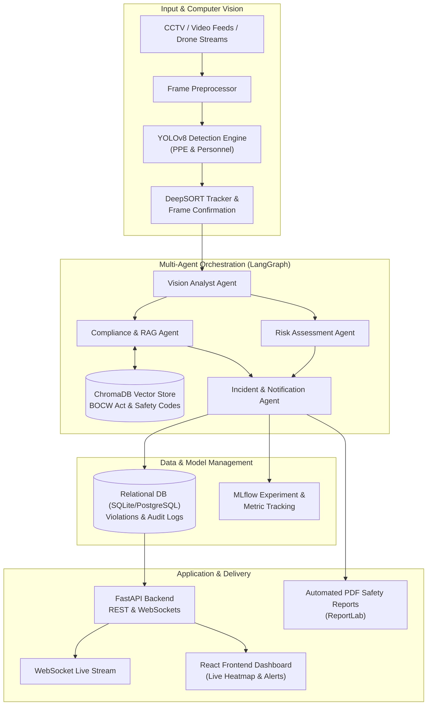

# RakshaSite — Autonomous Multi-Agent Construction Safety Compliance System

[](https://www.python.org/)
[](https://docs.ultralytics.com/)
[](https://github.com/langchain-ai/langgraph)
[](https://www.trychroma.com/)
[](https://fastapi.tiangolo.com/)
[](https://reactjs.org/)
[](LICENSE)

**RakshaSite** is an intelligent, autonomous multi-agent occupational safety compliance and hazard monitoring platform tailored for construction environments. Combining edge-capable computer vision (YOLOv8) with autonomous LLM agents orchestrated via LangGraph, RakshaSite continuously audits worksites for Personal Protective Equipment (PPE) compliance, cross-references site incidents against statutory regulations (such as India's **Building and Other Construction Workers (BOCW) Act, 1996** and OSHA standards) via ChromaDB RAG, dynamically assesses risk, and triggers real-time escalations.

---

## Key Highlights

- **Real-Time PPE Detection & Tracking**: Ultralytics YOLOv8 pipeline for identifying helmets, high-visibility safety vests, gloves, protective footwear, and safety harnesses with DeepSORT temporal tracking and multi-frame confirmation to eliminate false positives.
- **Multi-Agent Orchestration (LangGraph)**: Specialized, cooperative autonomous agents:
  - *Vision Analyst Agent*: Ingests detections and tracks spatial-temporal safety violations.
  - *Compliance & RAG Agent*: Queries a ChromaDB vector store of regulatory texts (BOCW Act, Central Rules, and OSHA standards) to identify statutory violations and mandatory penalties.
  - *Risk Assessment Agent*: Computes composite safety risk indices factoring in persistence, zone hazard ratings, and concurrent violations.
  - *Incident & Alert Agent*: Generates real-time push alerts, dispatches site notifications, and logs structured compliance records.
- **Statutory Regulatory RAG**: Semantic retrieval over legal compliance documentation to cite exact sections, penal codes, and required corrective actions.
- **Dynamic Risk Scoring**: Configurable multi-tier risk matrix (Low, Medium, High, Critical) with temporal confirmation gates.
- **Automated Safety Audits**: Auto-generated executive PDF safety inspection reports using ReportLab with statistical charts and violation logs.
- **Modern Full-Stack Architecture**: Asynchronous FastAPI backend delivering REST APIs and low-latency WebSocket live detection streams to a React dashboard.

---

## System Architecture



---

## Project Structure

```text
rakshasite/
├── .env.example              # Environment variables template
├── .gitignore                # Git ignore configuration
├── README.md                 # Project documentation
├── requirements.txt          # Python dependencies
├── configs/
│   └── config.yaml           # Master system configuration
├── data/
│   ├── raw/                  # Source videos and raw datasets
│   └── unified/              # Annotated datasets and processed frames
├── models/                   # YOLOv8 weights and exported checkpoints
├── knowledge_base/           # BOCW Act, OSHA PDFs, and regulatory documents
├── reports/                  # Generated audit reports and PDF summaries
├── frontend/                 # React frontend application
└── notebooks/                # Exploratory notebooks and training pipelines
```

---

## Getting Started (Fresh Clone Setup)

### Prerequisites

- **Python**: 3.10, 3.11, or 3.12
- **Node.js**: 18+ (for React frontend dashboard)
- **CUDA-compatible GPU**: Optional (runs at **98.3 FPS** on RTX 3050 GPU and **18.1 FPS** on CPU)
- **Groq API Key**: Optional (`GROQ_API_KEY` for cloud LLM narratives; runs **100% offline** with deterministic statutory fallback when omitted)

### Installation & Asset Unpacking

1. **Clone the repository and navigate to the project root:**
   ```bash
   git clone https://github.com/Chaitanya1914/rakshasite.git
   cd rakshasite
   ```

2. **Create and activate a virtual environment:**
   ```powershell
   # Windows (PowerShell)
   python -m venv .venv
   .\.venv\Scripts\Activate.ps1

   # Linux / macOS
   python3 -m venv .venv
   source .venv/bin/activate
   ```

3. **Install Python dependencies:**
   ```bash
   pip install --upgrade pip
   pip install -r requirements.txt
   ```

4. **Unpack the trained YOLOv8n weights (`models/best.pt`), demo video, and 50 validation photos:**
   ```bash
   python scripts/fetch_data.py --mirror dist/asset_mirror
   ```

---

## Usage

### 1. Run the One-Command End-to-End Demo (100% Offline Capable)
```bash
python demo_runner.py --offline
```
Generates:
- Annotated CCTV evidence video: `reports/demo_annotated_output.mp4`
- Peak violation snapshot: `reports/demo_snapshot_violation.jpg`
- Signed statutory BOCW PDF report: `reports/safety_audit.pdf`
- SHA-256 tamper-proof JSON log: `reports/demo_audit_log.json`

### 2. Launch the FastAPI Backend & Executive Command Center UI
```bash
uvicorn backend.api:app --host 0.0.0.0 --port 8000 --reload
```
- **Live Executive Command Center UI**: `http://localhost:8000/demo`
- **Interactive Swagger API Docs**: `http://localhost:8000/docs`
- **ReDoc API Reference**: `http://localhost:8000/redoc`

### 3. Run the Full Automated Test Suite (`269/269` Tests)
```bash
pytest tests/ -v
```

---

## Team Onboarding & Next Steps

### For Sejal — Backend & Database Lead (`sejal/backend-api`)
- **Full Step-by-Step Guide**: Read [`team/SEJAL_TASKS.md`](team/SEJAL_TASKS.md)
- **Files You Own**:
  - `src/database/models.py` — SQLAlchemy ORM tables (`Violation` & `ShiftReport`)
  - `src/database/crud.py` — Database queries (create violation, time-range filter, stats, repeat offenders)
  - `backend/schemas.py` — Pydantic v2 request/response validation schemas
  - `backend/api.py` — FastAPI REST endpoints (`/api/v1/analyze`, `/api/v1/analyze/image`, `/api/v1/analyze/video`, `/api/v1/analytics/{camera_id}`, `/api/v1/report/{shift_id}`, `/api/v1/regulations`)
- **How to Continue Your Tasks**:
  1. Run `uvicorn backend.api:app --reload` and open `http://localhost:8000/docs` to test all existing endpoints interactively.
  2. Create your branch (`git checkout -b sejal/backend-api`) and implement the next backend enhancements listed at the top of [`team/SEJAL_TASKS.md`](team/SEJAL_TASKS.md) (violation pagination `GET /api/v1/violations`, single-record delete `DELETE /api/v1/violations/{id}`, and CSV audit export `GET /api/v1/export/csv`).

### For Ashmeet — Frontend Lead (`ashmeet/frontend-ui`)
- **Full Step-by-Step Guide**: Read [`team/ASHMEET_TASKS.md`](team/ASHMEET_TASKS.md) and [`docs/FRONTEND_API_CONTRACT.md`](docs/FRONTEND_API_CONTRACT.md)
- Build the React + Tailwind dashboard inside `frontend/` consuming the live FastAPI endpoints on `http://localhost:8000`.

---

## Regulatory Compliance Context

RakshaSite actively maps detected non-compliance against statutory Indian provisions (`knowledge_base/bocw_act_1996_and_rules_1998.md`):
- **BOCW Act (1996) — Section 40(2)(a) & Central Rules (1998) — Rule 46**: Mandatory industrial safety helmets (`IS 2925:1984`).
- **BOCW Central Rules (1998) — Rule 43 & Rule 241(2)(c)**: Mandatory high-visibility reflective safety apparel.
- **BOCW Act (1996) — Sections 47–50**: Statutory penalty schedules and criminal liability provisions.

---

## License

This project is licensed under the MIT License — see the [LICENSE](LICENSE) file for details.
