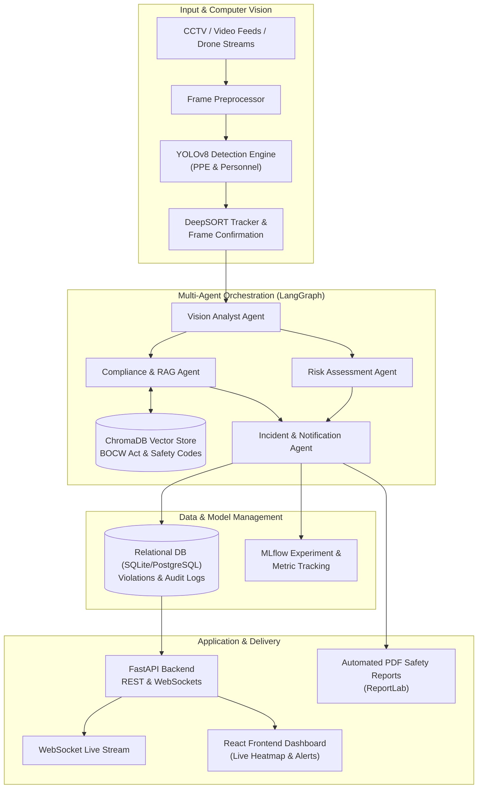

# RakshaSite — Autonomous Multi-Agent Construction Safety Compliance System

[](https://www.python.org/)
[](https://docs.ultralytics.com/)
[](https://github.com/langchain-ai/langgraph)
[](https://www.trychroma.com/)
[](https://fastapi.tiangolo.com/)
[](https://reactjs.org/)
[](LICENSE)

**RakshaSite** is an intelligent, autonomous multi-agent occupational safety compliance and hazard monitoring platform tailored for construction environments. Combining edge-capable computer vision (YOLOv8) with autonomous LLM agents orchestrated via LangGraph, RakshaSite continuously audits worksites for Personal Protective Equipment (PPE) compliance, cross-references site incidents against statutory regulations (such as India's **Building and Other Construction Workers (BOCW) Act, 1996** and OSHA standards) via ChromaDB RAG, dynamically assesses risk, and triggers real-time escalations.

---

## Key Highlights

- **Real-Time PPE Detection & Tracking**: Ultralytics YOLOv8 pipeline for identifying helmets, high-visibility safety vests, gloves, protective footwear, and safety harnesses with DeepSORT temporal tracking and multi-frame confirmation to eliminate false positives.
- **Multi-Agent Orchestration (LangGraph)**: Specialized, cooperative autonomous agents:
  - *Vision Analyst Agent*: Ingests detections and tracks spatial-temporal safety violations.
  - *Compliance & RAG Agent*: Queries a ChromaDB vector store of regulatory texts (BOCW Act, Central Rules, and OSHA standards) to identify statutory violations and mandatory penalties.
  - *Risk Assessment Agent*: Computes composite safety risk indices factoring in persistence, zone hazard ratings, and concurrent violations.
  - *Incident & Alert Agent*: Generates real-time push alerts, dispatches site notifications, and logs structured compliance records.
- **Statutory Regulatory RAG**: Semantic retrieval over legal compliance documentation to cite exact sections, penal codes, and required corrective actions.
- **Dynamic Risk Scoring**: Configurable multi-tier risk matrix (Low, Medium, High, Critical) with temporal confirmation gates.
- **Automated Safety Audits**: Auto-generated executive PDF safety inspection reports using ReportLab with statistical charts and violation logs.
- **Modern Full-Stack Architecture**: Asynchronous FastAPI backend delivering REST APIs and low-latency WebSocket live detection streams to a React dashboard.

---

## System Architecture



---

## Project Structure

```text
rakshasite/
├── .env.example              # Environment variables template
├── .gitignore                # Git ignore configuration
├── README.md                 # Project documentation
├── requirements.txt          # Python dependencies
├── configs/
│   └── config.yaml           # Master system configuration
├── data/
│   ├── raw/                  # Source videos and raw datasets
│   └── unified/              # Annotated datasets and processed frames
├── models/                   # YOLOv8 weights and exported checkpoints
├── knowledge_base/           # BOCW Act, OSHA PDFs, and regulatory documents
├── reports/                  # Generated audit reports and PDF summaries
├── frontend/                 # React frontend application
└── notebooks/                # Exploratory notebooks and training pipelines
```

---

## Getting Started

### Prerequisites

- **Python**: 3.10 or 3.11
- **Node.js**: 18+ (for frontend dashboard)
- **CUDA-compatible GPU**: Recommended for real-time video inference
- **Google Gemini API Key**: For multi-agent reasoning and RAG analysis

### Installation

1. **Clone the repository and navigate to the project root:**
   ```bash
   git clone https://github.com/your-org/rakshasite.git
   cd rakshasite
   ```

2. **Create and activate a virtual environment:**
   ```bash
   # Windows (PowerShell)
   python -m venv venv
   .\venv\Scripts\Activate.ps1

   # Linux / macOS
   python3 -m venv venv
   source venv/bin/activate
   ```

3. **Install Python dependencies:**
   ```bash
   pip install --upgrade pip
   pip install -r requirements.txt
   ```

4. **Set up environment variables:**
   ```bash
   cp .env.example .env
   ```
   Edit `.env` and configure your `GEMINI_API_KEY`, database URL, and model paths.

5. **Download or train YOLOv8 PPE weights:**
   Place your trained model checkpoint (e.g., `best.pt`) in the `models/` directory.

---

## Configuration

All core hyperparameters and service endpoints are centralized in [`configs/config.yaml`](file:///C:/Users/chait/.gemini/antigravity/scratch/rakshasite/configs/config.yaml):

- **`model`**: YOLO confidence threshold, IOU threshold, image size, classes, and DeepSORT tracking parameters.
- **`agents`**: LLM provider (Gemini), model names, temperatures, agent role definitions, and maximum retry iterations.
- **`rag`**: ChromaDB persistence directory, chunking size, overlap, embedding models, and knowledge base document directories.
- **`database`**: Connection string, connection pooling, and ORM settings.
- **`dashboard`**: API host, port, CORS allowed origins, WebSocket refresh intervals, and report output paths.
- **`risk_engine`**: Risk threshold boundaries (Medium: 40, High: 60, Critical: 80) and frame confirmation windows.

---

## Usage

### 1. Ingest Regulatory Knowledge Base
Index statutory safety regulations (BOCW Act, OSHA rules) into ChromaDB:
```bash
python -m rakshasite.rag.ingest_knowledge_base
```

### 2. Run the Multi-Agent Inference Pipeline
Run detection and agentic reasoning on a video feed or camera stream:
```bash
python -m rakshasite.pipeline.run_stream --source data/raw/site_camera_01.mp4
```

### 3. Launch FastAPI Backend
```bash
uvicorn rakshasite.api.main:app --host 0.0.0.0 --port 8000 --reload
```
Interactive API documentation will be available at:
- Swagger UI: `http://localhost:8000/docs`
- ReDoc: `http://localhost:8000/redoc`

### 4. Launch React Frontend
```bash
cd frontend
npm install
npm run dev
```
Open `http://localhost:5173` to access the live dashboard.

### 5. Generate Safety Audit PDF Reports
```bash
python -m rakshasite.reports.generate_report --date today --output reports/safety_audit.pdf
```

---

## Regulatory Compliance Context

RakshaSite actively maps detected non-compliance against statutory provisions:
- **BOCW Act (1996) - Section 40**: Safety precautions, provision of protective gear, safety nets, and helmets.
- **Central BOCW Rules (1998) - Chapter VII & VIII**: Head protection, eye and face protection, respiratory equipment, and fall protection harnesses.
- **OSHA Standard 1926**: Construction industry safety standards for personal protective and life saving equipment.

---

## Testing

Run unit and integration test suites:
```bash
pytest tests/ -v
```

---

## License

This project is licensed under the MIT License — see the [LICENSE](LICENSE) file for details.
